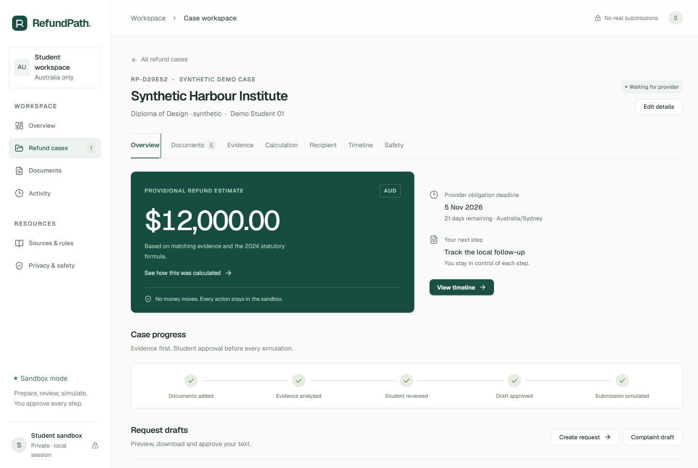

# RefundPath

Project repository for the **2026 Shenzhen International FinTech Competition**.

**Offline demo:** download [RefundPath-arayuzler.html](offline-demo/dist/RefundPath-arayuzler.html)
and open it in your browser. It runs without a server or API key. See the
[offline demo guide](offline-demo/README.md) for scenarios, source and checks.

**A student-controlled workspace for Australian education-fee refund requests.**

International students can struggle to reconcile their agreement, fee payments,
visa refusal and provider refund process. RefundPath brings that evidence into
one private case, shows a sourced provisional calculation when the conditions
are supported, flags uncertainty, prepares a request for student review and
tracks a **sandbox-only** workflow.

This is a local, Australia-only MVP for demonstration. It provides **no legal or
financial advice**, does not establish entitlement, and does not verify identity,
bank ownership, document authenticity or provider registration against a live
registry. A provider or qualified professional must confirm individual outcomes.



## What works

- Overview of open cases, estimates, provisional provider dates, pending reviews
  and local follow-up reminders; searchable case list and status filters.
- Case creation and editing: student, provider, course, event, original payer,
  proposed recipient, education level and Australian timezone.
- Separate agreement, invoice, receipt, policy/default evidence, visa-refusal
  and optional agent-document uploads; masked text preview and deletion.
- Local extraction from UTF-8 TXT and text PDFs. Every supported extracted field
  has a document, page, line, quotation, method and extraction confidence.
- Student corrections, evidence review, deterministic decimal calculations,
  recipient comparisons, risk reports and versioned legal-source inspection.
- Refund, follow-up and complaint drafts, downloads, explicit per-draft approval,
  local simulation, case history and resolution marking.
- A key-free local document assistant; optional external summarisation with
  explicit per-case opt-in and a separate summarisation request.
- Private browser sessions, case-owner checks, stale-approval invalidation,
  optimistic revisions, upload limits, redaction and expiry cleanup.

No button sends email, pays a refund, enters a provider portal, files a complaint
or contacts an ombudsman. **“Simulated submission” means a local database event.**
“Waiting for provider” is a simulated tracking state; no external response is
expected. “Resolved” records a student action and does not assert payment receipt.

## Supported and manual-review scenarios

The implemented estimate is for a **student-visa refusal causing failure to
start** at an Australian registered provider, under the checked statutory
conditions. It requires readable matching sources, a course that the provider
did start, no previous withdrawal, a confirmed agreed/default day, matching
pre-default AUD payments and a matching student payer/recipient. Course fees
received by the provider include tuition and non-tuition amounts; separate agent
fees are not automatically included.

The provisional deduction is the lesser of 5% of the relevant pre-default
provider course fees and AUD 500. The provider-obligation calendar estimate uses
the sourced default day and the applicable rule, **never a universal
visa-letter-date offset**. It is qualified for professional confirmation of
public holidays, extensions and other case-specific legal exceptions.

Other events, including visa-related withdrawal, provider default and
contract-specific claims, can be opened and tracked, with complaint drafts for
review, but their amount/date calculations remain manual in this MVP. Unknown
rules or expired rule review, unsupported currency, missing or contradictory
evidence, low confidence, agent/third-party payment, changed bank details or a
recipient mismatch suppress the estimate and deadline. Approval cannot override
these gates. No exchange-rate conversion is implemented.

PNG/JPEG files and scanned PDFs can be uploaded but need human extraction or a
readable text replacement; **there is no image OCR**. The local parser recognises
explicit labelled fields, not arbitrary contracts. Unrecognised text receives
manual review rather than invented values. See the synthetic templates below.

## Local setup

Prerequisites: Python 3.12 or 3.13, Node.js 20.19+ and npm. Docker is optional.

Windows PowerShell, from the repository root:

```powershell
python -m venv .venv
.\.venv\Scripts\python.exe -m pip install -r backend\requirements-refundpath-dev.txt
Copy-Item .env.example .env
Set-Location frontend
npm ci
Set-Location ..
```

Start the API in one terminal:

```powershell
Set-Location backend
..\.venv\Scripts\python.exe -m uvicorn app.main:app --host 127.0.0.1 --port 8000 --no-access-log
```

Start the frontend in another terminal:

```powershell
Set-Location frontend
npm run dev -- --host 127.0.0.1 --port 5173 --strictPort
```

Open **http://127.0.0.1:5173**. The Vite proxy forwards `/api` to the local backend.
SQLite tables are created on startup; no external services or API key are needed.
Use Ctrl+C in each terminal to stop. A convenience `Start-RefundPath.ps1` starts
both processes without visible windows; use `-Setup` to install missing packages.
The delivered desktop checkout includes a prepared minimal Python environment
and the production frontend build. Run `.\Start-RefundPath.ps1` and open
**http://127.0.0.1:8000** to use that build without installing frontend packages.
Use `-Dev` for the Vite development server after installing npm dependencies.
Use `.\Stop-RefundPath.ps1` to stop processes launched by that script.

On macOS/Linux, replace the Python executable with `.venv/bin/python` and use
`cp .env.example .env`. Run the same uvicorn and npm commands in their respective
directories.

Optional Docker:

```text
docker compose up --build
```

Open **http://127.0.0.1:3000**. Compose runs PostgreSQL, Alembic migrations, the
active RefundPath API and nginx/Vite build. No original demo data is seeded.
The Docker daemon must already be running. Do not deploy this local prototype as
a public document service without production authentication and storage hardening.

## Try the complete synthetic demo

1. Select **Matching documents** in Overview and click **Load demo case**.
2. Open Documents to preview the five synthetic sources. Every file is marked
   “SYNTHETIC REFUNDPATH DEMO — NOT AN OFFICIAL DOCUMENT”.
3. In Evidence, inspect values, quotation/page references and extraction
   confidence. Check the student-review box and **Confirm evidence review**.
4. Calculation shows AUD 12,500 provider course fees, AUD 500 provisional
   statutory deduction and an AUD 12,000 estimate. The default day is generated
   relative to the Australian demo date; the visa refusal has a different date.
5. In Overview, **Create request**, open the draft and review the text. Simulation
   remains disabled until the exact draft is explicitly approved.
6. Click **Simulate submission**. Only the local history changes. Timeline lets
   you schedule a local reminder, prepare a follow-up or mark the case resolved.

Also try **Missing document**, **Agent payment**, **Conflicting amount** and
**Untrusted instructions**. They deliberately demonstrate manual-review gates;
no amount or deadline is produced for a blocked case. Complaint drafts require
student approval and confirmation of the channel before simulation.

No real demo accounts are provided. Each browser obtains a separate sandbox.
The fixture uses `Demo Student 01` and `Synthetic Harbour Institute`; these are
fictional presentation labels, not an actual person or provider. There are no
passport, visa identity or bank-account numbers in these fixtures.

To create standalone synthetic TXT fixtures for uploading:

```powershell
Set-Location backend
..\.venv\Scripts\python.exe -m scripts.refundpath_demo_documents
```

The files are written to `backend/var/synthetic-demo/`, with instructions showing
their generated metadata. Upload each file into its corresponding category in a
new case. They are never sent to a remote OCR service.

## AI and decision rules

The LLM boundary is deliberately limited. A local deterministic assistant is
available by default (`LLM_PROVIDER=fake`). A configured external provider can
produce an **unverified summary of masked excerpts**, after stored per-case
opt-in plus a just-in-time request. It has no tools and cannot change facts,
recipients, calculations, deadlines, eligibility or submission state.

To enable optional external summaries, install the retained full requirements:

```powershell
.\.venv\Scripts\python.exe -m pip install -r backend\requirements-dev.txt
```

Set your chosen provider and its key/model in `.env`, restart the API, and opt in
in the case’s Safety tab. Do not place a key in source code. Live provider calls
were not exercised in the key-free demo. No external extraction or OCR is claimed.

Legal, date, money, currency and payer/recipient decisions live in
`backend/app/refundpath/engine.py`. The versioned registry is `rules.json`.
Excerpts and instructions inside documents are untrusted data. Instruction-like
text flags human review and blocks external summarisation; even an undetected
instruction has no executable channel into the rule engine.

## Architecture and preserved upstream work

The existing React/Vite/Tailwind, FastAPI, async SQLAlchemy and Alembic stack is
retained. `rp_cases` stores each case aggregate with an optimistic revision;
`rp_sessions` stores only hashes of random session tokens. The default database
is SQLite; PostgreSQL is supported by the same models and the new migration.

The original backend and its tests remain in `app/legacy_main.py` and `tests/`
for regression compatibility. Its agent, data fixtures, Redis, evals and historic
deployment/landing source are retained but **are not part of the active product**.
The active `app.main:app` exposes only RefundPath; it does not seed the original
data, expose the original routes or call the original action tools. The old
frontend source is retained unimported. No history or licence was rewritten.

See [implementation and threat model](docs/REFUNDPATH_ARCHITECTURE.md).

## Security, privacy and threat model

- Local processing by default. Raw file bytes are discarded; only masked text,
  source facts and student-entered case metadata are retained.
- Upload allowlist: PDF, TXT, PNG, JPEG; 5 MB/file, at most 12 documents/case;
  request, text and PDF-page bounds. Filenames are sanitised and never used as
  filesystem paths. Raw PDF/HTML content is not rendered or executed.
- Known passport, visa, identity and account labels and long numeric identifiers
  are masked. Redaction is heuristic, **not a promise of complete anonymisation**.
  Use synthetic/redacted files for the demonstration.
- No account numbers are collected by the case form. Recipient comparison does
  not verify a bank account or a person’s identity/authority.
- HttpOnly SameSite=Strict cookie, owner checks, mutation Origin checks and
  generic validation/error responses. Private input and exception content are
  not emitted by the active application’s normal logs.
- Evidence changes and reanalysis invalidate pending approval. Simulation checks
  evidence/rule versions again. A draft can be simulated once. Revision checks
  prevent concurrent overwrites.
- Sessions expire after 24 hours. Cleanup runs every minute while the backend
  runs, on startup and when starting a new session. If the backend is stopped,
  data remains on disk until it restarts. Case deletion removes the case aggregate;
  SQLite files/backups are not securely wiped.
- Local database encryption, malware scanning, robust OCR, production sign-in,
  live CRICOS checks, full legal coverage and production quotas are out of scope.

Risk indicators describe uncertainty or inconsistency; they do not establish
forgery or fraud. Complaint routing is provisional: education level, provider
type, jurisdiction and the provider complaint process need confirmation.

## Official legal sources

Checked **14 October 2026**. The registry records sections, effective/compilation
dates, versions, URLs and last-check dates. Review expires on 12 January 2027;
no live monitoring or silent rule refresh is implemented.

- [ESOS Act 2000, current register](https://www.legislation.gov.au/C2004A00757/latest):
  compilation 45, 5 December 2025; section 5 and sections 47A, 47D(5), 47E.
- [Calculation of Refund Instrument 2024](https://www.legislation.gov.au/F2024L01231/latest):
  F2024L01231; effective 1 October 2024; section 10 and Schedule 1. It replaces
  the repealed 2014 specification.
- [Department of Education, international students / TPS](https://www.education.gov.au/tps/international-students).
- [Department of Education, provider obligations](https://www.education.gov.au/tps/international-providers-tps).
  This page’s agreement paragraph still cites the old specification; the
  authoritative 2024 instrument is used for this MVP’s calculation.
- [Commonwealth Ombudsman, international student complaints](https://www.ombudsman.gov.au/complaints/international-student-complaints).
  Higher education, private VET and public VET can require different channels.
  Unknown cases remain unconfirmed; no complaint is actually submitted.

## Tests, lint, typecheck and build

Active product tests and backend lint, from `backend/`:

```powershell
..\.venv\Scripts\python.exe -m pytest refundpath_tests -q
..\.venv\Scripts\python.exe -m ruff check .
```

The retained upstream regression suite requires `requirements-dev.txt`. To avoid
auto-loading optional telemetry pytest plugins during local testing:

```powershell
$env:PYTEST_DISABLE_PLUGIN_AUTOLOAD = '1'
$env:LLM_PROVIDER = 'fake'
..\.venv\Scripts\python.exe -m pytest -p pytest_asyncio.plugin tests refundpath_tests -q
```

Frontend checks, from `frontend/`:

```text
npm run lint
npm run typecheck
npm test
npm run build
```

Production output is `frontend/dist/`. A backend must still serve `/api`; a plain
static preview alone cannot complete the workflow.

The tests cover matched fees and source dates, missing/conflicting evidence,
confidence, agent/third-party payment, unsupported deductions, currency, payer
and recipient mismatches, document injection, absent/expired rule versions,
calendar/DST/leap-year boundaries, approval gates, stale drafts, repeated
simulation, session isolation, file limits, redaction, private error logging,
complaint-channel uncertainty, consent, retention and concurrent revisions.
See [validation record](docs/REFUNDPATH_VALIDATION.md) for actual results and limits.

To check migrations on a fresh local database, from `backend/`:

```powershell
$env:DATABASE_URL = 'sqlite:///var/migration-check.db'
..\.venv\Scripts\python.exe -m alembic upgrade head
..\.venv\Scripts\python.exe -m alembic check
Remove-Item Env:DATABASE_URL
```

## Screenshots and design provenance

Screenshots in `docs/screens/` use only synthetic data. To reproduce, load the
matching demo and capture Overview or a case at desktop 1440×960 and mobile
390×844. Also check keyboard Tab/arrow navigation, focus, upload errors and
draft approval before simulation.

[21st.dev](https://21st.dev/) was inspected as a visual reference. No third-party
component code with unclear licence was copied. The existing UI primitives,
Tailwind, Geist fonts and Lucide icons are reused; new layout and styling are
original to this implementation. Respect dependency licences in their packages.

## Licence

The supplied repository has **no root licence file**. No new project licence is
invented and existing licence terms have not been changed. The absence of a
licence is not a grant of redistribution rights. Obtain permission from the
repository owner before redistribution; dependencies retain their own licences.
